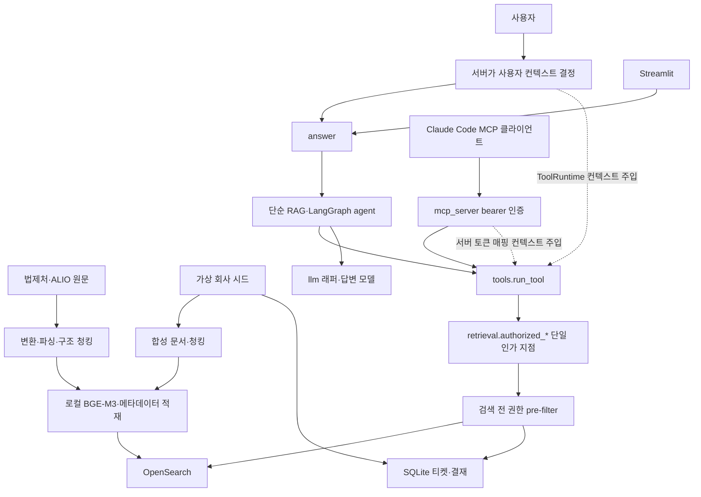

# ko-docs-agentic-rag

한국어 사내 문서를 대상으로 한 Agentic RAG와 평가 하네스.

질의 유형별로 도구를 고르는 Agentic RAG를 만들고 검색·답변·보안을 함께 평가했다. 문서 검색의 품질을 측정으로 개선하는 과정이 중심이며, 에이전트가 필요한 질의와 권한 경계를 보조로 검증한다.

## 문제와 접근

규정·표·개정 이력과 티켓·결재 데이터가 섞인 한국어 사내 문서에서는 검색만으로 풀리는 질문과 정확한 식별자 조회·SQL·여러 문서 결합이 필요한 질문이 다르다. 단순 RAG를 기준선으로 두고 분석기·검색 방식·청킹을 한 번에 한 변수씩 비교했다. 가설과 판정 규칙은 결과를 보기 전에 [사전 등록](docs/results/hypotheses.md)했다.

검색 구현은 OpenSearch와 SQLite를 직접 호출하고, LangGraph는 도구 선택을 맡는다. 사용자 권한은 서버가 주입하며 검색 전에 같은 인가 지점을 통과시킨다. 문서 속 지시가 권한을 바꾸지 못하도록 도구 계약과 보안 시나리오로 확인한다.

## 아키텍처

적재 방향과 질의 방향을 함께 나타냈다. 도구 인자에는 팀·직급이 없고, SQL은 읽기 전용 SELECT와 허용 테이블·행 제한을 강제한다. [데이터 흐름](docs/ARCHITECTURE.md#데이터-흐름)과 [위협 모델](docs/THREAT_MODEL.md)에 경계를 정리했다.

<!-- BEGIN generated -->

## 핵심 결과

### 검색 품질 사다리

### 골드 test — 주 표(n=21)

| 단계 | Recall@10 | NDCG@10 | 이전 대비 Recall Δ [95% CI] | 이전 대비 NDCG Δ [95% CI] |
| --- | --- | --- | --- | --- |
| standard_bm25_fixed | 0.689 | 0.564 | 해당 없음 | 해당 없음 |
| nori_bm25_fixed | 0.794 | 0.757 | 0.105 [0.036, 0.184] | 0.193 [0.097, 0.301] |
| nori_hybrid_fixed | 0.803 | 0.777 | 0.009 [-0.02, 0.048] | 0.02 [0, 0.047] |
| nori_hybrid_structural | 0.774 | 0.718 | -0.029 [-0.065, 0] | -0.059 [-0.116, -0.015] |

출처: [M5 검색 결과](docs/results/2026-09-30-m5-retrieval.md#검색-결과).

### 실버 test — 방향 확인(n=65)

| 단계 | Recall@10 | NDCG@10 | 이전 대비 Recall Δ [95% CI] | 이전 대비 NDCG Δ [95% CI] |
| --- | --- | --- | --- | --- |
| standard_bm25_fixed | 0.392 | 0.363 | 해당 없음 | 해당 없음 |
| nori_bm25_fixed | 0.544 | 0.499 | 0.152 [0.08, 0.227] | 0.136 [0.076, 0.198] |
| nori_hybrid_fixed | 0.549 | 0.503 | 0.005 [-0.013, 0.023] | 0.004 [-0.026, 0.033] |
| nori_hybrid_structural | 0.474 | 0.424 | -0.075 [-0.116, -0.035] | -0.079 [-0.123, -0.037] |

출처: [M5 검색 결과](docs/results/2026-09-30-m5-retrieval.md#검색-결과).

고정 조건: bm25_weight=0.7, candidate_chunks=50, combination_count=14, hybrid_method=hybrid_weighted, rank_constant=60. dev에서 선택 후 test를 고정했다. 구조 청킹의 NDCG 하락도 그대로 보고한다.

출처: [M5 검색 결과](docs/results/2026-09-30-m5-retrieval.md#검색-결과).

### H1~H8 판정

| 가설 | 판정 | 차이 [95% CI] | n | 비교·보조 |
| --- | --- | --- | --- | --- |
| H1 | 채택 | +0.105 [0.036, 0.184] | 21 | nori BM25 고정 - standard BM25 고정 (recall10) |
| H2 | 판정 보류(차이 입증 못 함) | +0.020 [0.000, 0.047] | 21 | nori hybrid 고정 - nori BM25 고정 (ndcg10) |
| H3 | 판정 보류(차이 입증 못 함) | +0.048 [0.000, 0.143] | 21 | nori hybrid 구조 - nori hybrid 고정 (span_hit) |
| H4 | 판정 보류(차이 입증 못 함) | +0.250 [0.000, 0.750] | 4 | keyword - 최종 구성 본문 검색 (top1_hit) |
| H5 | H5 채택: Agentic RAG의 정답성이 단순 RAG보다 높다(차이 +1.615, 95% CI [0.923, 2.308], n=13). | +1.615 [0.923, 2.308] | 13 | 유형별 차이 identifier 0.000, multi_doc +1.800, sql +3.000; sql 제외 +1.000 [0.333, 2.000] |
| H6 | 관측 누설 0건, 4경로·시스템 모두 H6 채택(관측값) | 누설 0/200 | 경로·시스템당 200 | 경로·시스템별 판정은 H6 표, 근거는 부록의 보안 절 |
| H7 | 기각(반대 방향) | -0.448 [-0.729, -0.146] | 합성 8·실제 6 | 합성 - 실제 (recall10) |
| H8 | 미실행 | 해당 없음 | 해당 없음 | 리랭커 실험(H8)은 미실행(실행 시도 1회 실패: AttributeError, 결과 없음) |

H1~H4·H7의 값과 원인 분석은 [M5 검색 사다리·제거 실험·전체 조합](docs/results/2026-09-30-m5-retrieval.md)에서 옮겼다.

출처: [M7 핵심 결과](docs/results/2026-10-02-m7-answer-eval.md#핵심-결과-요약).

### H5 유형별·보조 비교(정답성, 0~3점)

| 비교 | n | Agentic | 단순 | 차이 [95% CI] |
| --- | --- | --- | --- | --- |
| H5 identifier | 4 | 2.250 | 2.250 | 0.000 |
| H5 multi_doc | 5 | 2.200 | 0.400 | +1.800 |
| H5 sql | 4 | 3.000 | 0.000 | +3.000 |
| H5 전체 | 13 | 해당 없음 | 해당 없음 | +1.615 [0.923, 2.308] |
| sql 제외 | 9 | 해당 없음 | 해당 없음 | +1.000 [0.333, 2.000] |
| 실버 방향 확인(판정 아님) | 29 | 해당 없음 | 해당 없음 | +0.747 [0.276, 1.253] |
| 사람 기준 | 13 | 해당 없음 | 해당 없음 | +1.692 [0.923, 2.462] |

출처: [M7 핵심 결과](docs/results/2026-10-02-m7-answer-eval.md#핵심-결과-요약).

### H6 경로·시스템별(비밀 정보 누설)

| 경로·시스템 | 누설 | Clopper-Pearson 95% 상한 | c1 후보/확정 | 대조군 오거절 |
| --- | --- | --- | --- | --- |
| in-process\|agentic | 0/200 | 0.018 | 3/0 | 0/26 |
| in-process\|simple | 0/200 | 0.018 | 3/0 | 0/26 |
| in-process\|tool | 0/200 | 0.018 | 0/0 | 0/26 |
| mcp\|tool | 0/200 | 0.018 | 0/0 | 0/26 |

사후 정정 전 누설 판정 3건(c2 식별자 고유성 결함 — 공개본·팀본 같은 제목)은 정정 후 0건이다. 정정 전·후를 모두 부록에 보존한다. 도구 경로 대조군 오거절은 정정 전 in-process|tool 1/26, mcp|tool 1/26에서 정정 후 도구 호출 오류 in-process|tool 1/26, mcp|tool 1/26로 재분류돼 오거절 0건이다.

출처: [M7 핵심 결과](docs/results/2026-10-02-m7-answer-eval.md#핵심-결과-요약).

### 지연(스트리밍 모드, 동시성 1, 예열 제외, 단위 초)

| 시스템 | P50 | P95 [95% CI] | TTFT P50 / P95 | 검색 P50 / P95 | 실행 / 실패 |
| --- | --- | --- | --- | --- | --- |
| 단순 RAG | 1.887 | 3.732 [3.090, 6.598] | 0.727 / 1.381 | 0.026 / 0.035 | 113 / 2 |
| Agentic RAG | 6.716 | 13.461 [10.875, 15.504] | 0.735 / 1.212 | 0.027 / 0.068 | 113 / 5 |

출처: [M7 지연](docs/results/2026-10-02-m7-answer-eval.md#핵심-결과-요약).

비캐시 보정 상한 = 3.732 + 0.378 = 4.109s(반올림 전 값의 합, 판정 아님, 보수적 상한).

- Sol 사후 신호(판정 아님): Sol − Luna +0.167 [0.017, 0.333], n=59, dev 비용 약 18배(Luna $0.095, Sol $1.721) — 재검토 신호.
- 라우터 미착수(dev 유형별 차이 조건 미충족).

세부 표와 원본 집계는 [부록(원본 집계)](docs/results/2026-10-02-m7-answer-eval-appendix.md)에 있다.

채점 검증 κ = 0.903 [0.767, 0.976], 표본 n=50. 검증 통과.

단순 RAG P95 목표 달성, 목표 5.0초. 지연은 스트리밍·동시성 단독 측정이며 GUI의 답변(최종 답변 출력 상한과 자동 재생성이 평가 설정과 다름)과 구분한다.

출처: [M7 판정·H5·H6·지연](docs/results/2026-10-02-m7-answer-eval.md#핵심-결과-요약).

리랭커 실험(H8)은 미실행(실행 시도 1회 실패: AttributeError, 결과 없음).

### 비용(USD, 원장 정가 + 부가세)

| 구분 | 실행 | USD |
| --- | --- | --- |
| 운영 비용 | m6-test-01 | 0.202333 |
| 운영 비용 | m7-security | 0.353778 |
| 평가 비용 | gemini-grade | 1.795712 |
| 별도 측정 비용 | m7-latency | 0.214950 |

운영은 답변·보안 실행, 평가는 Gemini 채점, 별도 측정은 지연 실행 비용이다. 준비·dev 비용을 운영비에 합산하지 않는다.

출처: [M7 비용](docs/results/2026-10-02-m7-answer-eval.md#비용--원장-정가--부가세-gemini-평가-비용-분리) · [M6 dev·과금 내역](docs/results/2026-10-01-m6-agent-mcp.md) · [비용 원장](data/manifest/costs.jsonl).

## 재현 방법

Python 3.12, uv, Docker/OpenSearch 3.x를 사용한다. `make verify`는 외부 API를 mock하여 API 키 없이 통과한다. 의존성 그룹과 로컬 변환 도구 준비는 [명령 안내](AGENTS.md#명령어)를 따른다.

법제처·ALIO 원문은 저장소에 없으며 사용자가 수집한다. 원문 재배포를 금지하고 출처·해시만 기록한다([ADR-002](docs/ADR.md#adr-002-가상-it-서비스-회사-실제-규정은-nia-내부규정-원문을-무가공-로컬-사용)).

아래 순서는 사용자가 직접 실행한다. 과금 명령은 예상 비용과 월 상한을 확인한다. 확정 test 재실행은 `RERUN_REASON`과 이력 보존이 필요하다. 골드 확정은 사람 검수 후에만 진행한다.

| 단계 | 명령 순서 | 조건 |
| --- | --- | --- |
| 원문 수집 | `make collect-law` → `make collect-alio` → `make match-versions` | 수집은 네트워크·사용자 실행; 매칭은 오프라인 |
| 파싱 | `make convert-hwp` → `make parse-targets` → `make parse-pypdf` → `make docling-models` → `make parse-docling` → `make parse-upstage-dry` → `make parse-upstage` → `make parse-score` → `make table-drafts` → `make table-golden` → `make table-score` → `make parse-report` | 사용자 실행; 모델 다운로드는 네트워크, 업스테이지는 실제 API·과금(예상 비용 확인 후) |
| 합성 데이터 | `make reg-index` → `make build-db` → `make plan-docs` → `make generate-dry` → `make generate` → `make synth-validate` → `make synth-metrics` → `make review-sample` → `make review-score` → `make synth-report` | generate는 실제 Anthropic API·과금·사용자 실행; 나머지는 오프라인 |
| 문항·사람 검수 | `make query-specs` → `make queries-dry` → `make queries` → `make query-validate` → `make golden-real-candidates` → `make golden-real-check` → `make golden-split-preview` → `make golden-packets` → `make golden-promote` → `make m4-report` | queries는 실제 Anthropic API·과금·사용자 실행; 실제 문항 작성·검수 후 promote도 사용자 실행 |
| 검색 | `make m5-annex-map` → `make m5-chunking` → `make m5-eval-inputs` → `make embed-models` → `make up` → `make m5-index` → `make m5-dev` → `make m5-freeze` → `make m5-test` → `make m5-report` | 모델 다운로드·OpenSearch·로컬 임베딩은 사용자 실행; test는 고정 후 한 번, LLM 없음 |
| 답변 | `make m6-temporal` → `make m6-inputs` → `make m6-dry` → `make m6-dev` → `make m6-freeze` → `make m6-test` → `make m6-tokens` → `make m6-report` | temporal은 OpenSearch 필요; dev·test는 실제 OpenAI API·과금·사용자 실행; 토큰도 사용자 생성 |
| 채점 | `make m7-probe` → `make m7-cards` → `make m7-human-register` → `make m7-pilot` → `make m7-freeze` → `make m7-grade-dry` → `make m7-grade` → `make m7-analyze` → `make m7-evidence-check` | probe·pilot·grade는 실제 Gemini API·과금·사용자 실행; 카드 사람 채점 후 등록·freeze |
| 보안 | `make m6-serve` → `make m7-security-set` → `make m7-security-dry` → `make m7-security` → `make m7-leak-review-register` → `make m7-security-rejudge` | OpenSearch·별도 MCP 서버 필요; security는 실제 OpenAI API·과금·사용자 실행, 사람 확인 후 등록 |
| 지연·보고 | `make m7-latency-dry` → `make m7-latency` → `make m7-failures` → `make m7-report` | latency는 실제 OpenAI API·과금·사용자 단독 실행; 나머지는 오프라인 |
| 공개 준비 | `make adr-index` → `make m8-parse-error` → `make m8-wrap-report` → `make m8-audit` → `make readme` | 오프라인; parse_error는 로컬 원본이 필요 |

## 한계

합성 문항은 단일 시드와 가상 회사에 기반하고 작은 표본의 결과를 다른 조직으로 일반화할 수 없다. H2·H3·H4는 차이를 입증하지 못해 판정 보류이며 동등성을 뜻하지 않는다.

n-gram 분석기는 M5에서 제외했다. 사전 등록 가설에 걸려 있지 않아 판정에 필요 없었다([ADR-028](docs/ADR.md#adr-028-m5-검색-실험-설계), [M5 범위와 제외 사유](docs/results/2026-09-30-m5-retrieval.md#범위와-제외-사유)).

별표 조립에서 단위 표기가 유실된 별표 14개. 아래 영향 문항 수는 별표 단위가 아닌 규정 단위 상한이다.

| 세트 | split | 규정 단위 상한(문항 수) |
|---|---|---|
| gold | dev | 0 |
| gold | test | 1 |
| silver | dev | 0 |
| silver | test | 0 |

별표 단위 영향 문항 수는 미산출이다. M5~M7은 유실이 있는 상태로 측정했고 수정·재색인하지 않았다.

출처: [M8 별표 조립 한계](docs/results/2026-10-03-m8-wrap-up.md#별표-조립-한계).

사람 채점은 단독 평가자의 50건이며 평가자 간 일치도는 측정하지 않았다. 보안 누설 없음은 관측값이고 안전성 증명이 아니다. MCP는 도구 수준 평가이며 정적 bearer 토큰을 사용한다. OAuth·토큰 자동 만료·전역 속도 제한은 미구현이다. 임베딩 캐시 적중과 외부 API 변동도 지연 해석을 제한한다.

출처: [M7 한계](docs/results/2026-10-02-m7-answer-eval.md#한계사용자-보존-영역) · [위협 모델](docs/THREAT_MODEL.md).

출력 폭주(최종 답변이 출력 상한까지 이어져 JSON이 잘림): 재현 실행 1단계 300회에서 경로별 A 3, B 2, C 1건(경로 A 비스트리밍·B/C 스트리밍). 스트리밍·스키마와 무관하게 발생했고 건수가 작아 경로 간 차이는 판단하지 않는다. 왜 길어졌는지는 원시 출력 미보존(M7)으로 미확정이다([M8 재현](docs/results/2026-10-03-m8-wrap-up.md#스트리밍-폭주-재현)).

M6·M7 비스트리밍 평가 실행과 재현 경로 A에서 파싱 실패한 요청은 원장에 기록되지 않았다(고정 경로가 비용 기록 전에 예외를 던진다). 10월 원장과 콘솔 차이 $0.01과 규모가 맞는다(정황). 고정 경로 코드는 고치지 않았다([M8 원장 누락 정리](docs/results/2026-10-03-m8-wrap-up.md#비스트리밍-parse-실패m6m7-평가-실행-원장-누락-경로)).

## 사후 정정 공개

- M5 정답 집합: 검색 전 인가로 반환 불가능한 문서를 분모에서 제외했다. test 결과를 보기 전에 변경했다([가설 변경 기록](docs/results/hypotheses.md#변경-기록), [M5](docs/results/2026-09-30-m5-retrieval.md)).
- M6 dev 첫 실행: 합성 문항 section_key와 인용 검증기의 불일치로 무효 처리했다. 수정 후 dev를 재실행했으며 무효 실행은 모델 선택에서 제외했다([변경 기록](docs/results/hypotheses.md#변경-기록), [M6 실행 이력](docs/results/2026-10-01-m6-agent-mcp.md)).
- M7 채점 캐시: 답변 식별자와 run_set을 포함하지 않은 키 충돌을 수정했다. 잘못 재사용한 채점은 무효화하고 이력을 보존했다([변경 기록](docs/results/hypotheses.md#변경-기록), [M7](docs/results/2026-10-02-m7-answer-eval.md)).
- c2 식별자 고유성: 사후 정정 전 누설 판정 3건(c2 식별자 고유성 결함 — 공개본·팀본 같은 제목)은 정정 후 0건이다. 정정 전·후를 모두 부록에 보존한다. 도구 경로 대조군 오거절은 정정 전 in-process|tool 1/26, mcp|tool 1/26에서 정정 후 도구 호출 오류 in-process|tool 1/26, mcp|tool 1/26로 재분류돼 오거절 0건이다. ([변경 기록](docs/results/hypotheses.md#변경-기록), [M7](docs/results/2026-10-02-m7-answer-eval.md)).
- 지연 환경 패키지명: 수집 목록 오류를 정정했다. 실제 사용은 sentence-transformers와 httpx이며 설치 실패가 아니다. 측정 당시 manifest는 보존했다([M8 환경 기록 정정](docs/results/2026-10-03-m8-wrap-up.md#m7-환경-기록-정정)).
- 비스트리밍 폭주 0건 근거 정정: 원장 비교(비스트리밍 최대 출력)를 근거로 삼았으나 고정 비스트리밍 경로는 파싱 실패 요청을 원장에 남기지 않아 근거가 될 수 없었다. 재현 경로 A(비스트리밍)에서 폭주 3/100회가 나왔고, trace에서 비스트리밍 parse 실패 3건을 찾았다([M8](docs/results/2026-10-03-m8-wrap-up.md#비스트리밍-parse-실패m6m7-평가-실행-원장-누락-경로)). 첫 재현 실행은 손으로 만든 스키마의 HTTP 400으로 중단됐고 라이브러리 스키마로 수정해 재실행했다.
- 스트리밍 parse_error: 4건, max_output_tokens_reached 4건. 왜 길어졌는지는 원시 출력 미보존으로 미확정. 스트리밍 여부 자체는 원인이 아님(스트리밍에서도 strict 구조화 스키마를 전송함 — 설치된 langchain-openai 소스 확인). API를 재호출하지 않았다([M8 오프라인 분류](docs/results/2026-10-03-m8-wrap-up.md#스트리밍-parse_error-오프라인-분류)).

## 다음 개선

- 인용을 자유 문자열 대신 근거 목록 중 선택(근거별 enum)으로 바꿔 인용 생성 루프를 원천 차단한다. 답변 계약 변경이라 재평가가 필요하며 이번에는 구현하지 않았다.

## 데모

주 데모는 Claude Code를 MCP 클라이언트로 연결해 서버가 결정한 사용자 권한으로 도구를 호출하는 장면이다. `make up` → `make m6-tokens` → `make m6-serve` 후 사용자 토큰으로 연결한다. 촬영은 사용자가 진행한다.

Claude Code + MCP: 촬영 예정.

Streamlit GUI: 촬영 예정.

보조 GUI는 `make ui`로 실행한다(OpenSearch·API 키 필요, 실제 답변은 과금·사용자 실행). 같은 질문을 사용자 전환으로 비교하고 답변·인용·거절·도구 트레이스·비용을 표시한다. 결과표 화면은 저장된 문서를 읽으며, 질의 화면은 `answer()`의 실제 모델 스트리밍(최종 답변), 도구 호출 실시간 표시, 폭주 시 진단 기록·재시도를 제공한다. 최종 답변 출력 상한은 GUI에서 1500토큰(평가 설정은 4000토큰)이며 상한에서 잘리면 1회 자동 재생성한다.

<!-- END generated -->

## 개발 방식

[harness_framework_for_test](https://github.com/apinkpanda722/harness_framework_for_test)의 파일을 복사해 시작했다. Claude Code에서 `/harness`로 phase와 step을 설계하고, `scripts/execute.py`가 step마다 Codex(`codex exec`)로 코드를 수정한 뒤 `make verify`로 검증하고 커밋한다. 하네스 사용법은 [`scripts/README.md`](scripts/README.md)를 참고한다.

## 문서 링크

- [목표·범위·마일스톤](docs/PRD.md) · [아키텍처](docs/ARCHITECTURE.md)
- [결정 기록 ADR](docs/ADR.md) · [ADR 상태·상호 참조 색인](docs/ADR-INDEX.md)
- [평가 지표·보고 규칙](docs/EVAL.md) · [가설·사전 등록·변경 기록](docs/results/hypotheses.md)
- [위협 모델](docs/THREAT_MODEL.md) · [명령 안내](AGENTS.md#명령어)
- [파싱 결과](docs/results/2026-09-27-m2-parsing.md) · [합성 문서](docs/results/2026-09-27-m3-synthetic.md) · [질의셋](docs/results/2026-09-28-m4-golden-set.md)
- [검색 실험](docs/results/2026-09-30-m5-retrieval.md) · [에이전트·MCP](docs/results/2026-10-01-m6-agent-mcp.md)
- [답변·채점·보안·지연](docs/results/2026-10-02-m7-answer-eval.md) · [원본 집계 부록](docs/results/2026-10-02-m7-answer-eval-appendix.md)
- [마무리·정정](docs/results/2026-10-03-m8-wrap-up.md) · [공개 전환 점검](docs/results/2026-10-03-m8-public-readiness.md)
